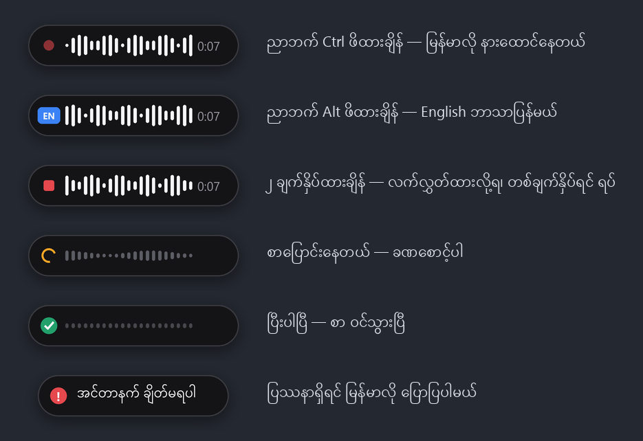

# Myanmar Flow

**မြန်မာလို ပြောလိုက်ရုံနဲ့ ဘယ် app မှာမဆို စာဝင်တဲ့ Windows နဲ့ Mac program**
*Burmese voice typing for Windows and macOS · [English](#english)*



<p align="center">
  <a href="https://github.com/ThecrashO/myanmar-flow/releases/latest"><b>⬇️ Download (Windows · Mac · အခမဲ့)</b></a>
  &nbsp;·&nbsp;
  <a href="docs/GUIDE.md"><b>📘 အသုံးပြုနည်း လမ်းညွှန်</b></a>
</p>

---

## စသုံးနည်း

1. **Install** — `MyanmarFlow-Setup.exe` ကို ဖွင့်ပါ။ အပြာရောင် box ပေါ်ရင် **More info → Run anyway** ([ဘာလို့လဲ?](docs/GUIDE.md#s3))
2. **API key ထည့်** — Wizard က မြန်မာလို လမ်းပြပေးပါမယ်။ Google account နဲ့ အခမဲ့ ယူရပါတယ် ([အသေးစိတ်](docs/GUIDE.md#s4))
3. **ပြော** — စာရိုက်မယ့်နေရာ နှိပ် → **ညာဘက် `Ctrl`** ဖိထား → ပြော → လွှတ်

| လုပ်ချင်တာ | လုပ်ရမှာ |
|---|---|
| မြန်မာလို ရိုက်မယ် | **ညာ `Ctrl`** ဖိ → ပြော → လွှတ် |
| မြန်မာလိုပြော၊ English ထွက် | **ညာ `Alt`** ဖိ → ပြော → လွှတ် |
| စာရှည် လက်မလိုဘဲ | Key **၂ ချက်** နှိပ် → ပြော → **၁ ချက်** နှိပ်ရင် ရပ် |
| Settings / အကူအညီ | နာရီဘေးက icon ကို **Right-click** |

> 🍎 **Mac** — `MyanmarFlow-mac.zip` ကို download လုပ်ပါ (Intel Mac ဆိုရင် `MyanmarFlow-mac-intel.zip`)။ Key က **ညာ `Option`** (English က **ညာ `Command`**)။ [Mac လမ်းညွှန် →](docs/GUIDE.md#mac)

## ဘာတွေ လုပ်ပေးလဲ

- **ပြောနေတုန်း စာပေါ်** — key လွှတ်တာနဲ့ စာ ချက်ချင်းဝင်
- **AI စာပြင်** — အကြားမှားတဲ့ စာလုံး၊ စာလုံးပေါင်း၊ ၊ ။ တွေကို အလိုလို ပြင်
- **English ဘာသာပြန်** — မြန်မာလို ပြောပြီး English စာ ထွက်
- **Shortcut** — "ငါ့လိပ်စာ" လို့ ပြောရင် လိပ်စာအပြည့် ဝင်
- **Dashboard** — အချိန် ဘယ်လောက် သက်သာလဲ၊ ခုနက ပြောခဲ့တဲ့စာ ပြန်ယူ
- **Privacy** — ကိုယ်ပိုင် API key နဲ့ Google ဆီပဲ ပို့၊ ပြောတဲ့စာ ဘယ်မှာမှ မသိမ်း

## သိထားရန်

- **Internet** လိုပါတယ်။ Free API key မှာ **တစ်ရက် limit** ရှိပါတယ် ([အသေးစိတ်](docs/GUIDE.md#s12))။
- Google က **မြန်မာနိုင်ငံထဲမှာ Gemini API ကို ခွင့်မပြုသေးပါ** ([စာရင်း](https://ai.google.dev/gemini-api/docs/available-regions))။

**အကူအညီ:** [ပြဿနာဖြေရှင်းနည်း](docs/GUIDE.md#s14) · [FAQ](docs/GUIDE.md#s15) · [ပြဿနာ / အကြံ တင်ရန်](https://github.com/ThecrashO/myanmar-flow/issues/new/choose) (မြန်မာလို ရေးလို့ရ)

---

<a name="english"></a>

## English

**Myanmar Flow** is a small tray / menu-bar app for Burmese voice typing on Windows and macOS (Apple Silicon and Intel). Hold **Right Ctrl** (Mac: **Right Option**), speak, release, and the text is pasted into whatever app has focus. Hold **Right Alt** (Mac: **Right Command**) to speak Burmese and get English. Double-tap either key for hands-free dictation. On a Mac, allow Microphone and Accessibility when asked.

It uses your own free [Gemini API key](https://aistudio.google.com/apikey). The Gemini API is [not available in Myanmar](https://ai.google.dev/gemini-api/docs/available-regions) yet.

<details>
<summary><b>How it works and building from source</b></summary>

- Streams audio to `gemini-3.5-transcribe-live` and shows the words while you speak; falls back to batch `gemini-3.5-transcribe` (`my-MM`, `en-US`) if streaming fails.
- Optional clean-up pass with `gemini-3.6-flash` fixes misheard words, spelling and punctuation, then fixes common Burmese look-alikes (၀/ဝ, ၇/ရ, ဥ/ဉ) and mark order.
- Voice shortcuts, personal word fixes, and a dashboard of time saved. Transcripts are never logged; history stays in memory.

```bash
py -m venv .venv
.venv\Scripts\python -m pip install -r requirements.txt
.venv\Scripts\pythonw myanmar_flow.py
```

Platform code lives in `platform_win.py` and `platform_mac.py`. `build.bat` builds `dist\MyanmarFlow.exe` with PyInstaller, and `installer.iss` builds the installer with [Inno Setup](https://jrsoftware.org/isinfo.php). Pushing a `v*` tag builds the Windows installer and the two Mac zips (Apple Silicon and Intel) on GitHub Actions and publishes a release.

</details>

License: [MIT](LICENSE) · Full guide (Burmese): [docs/GUIDE.md](docs/GUIDE.md)
