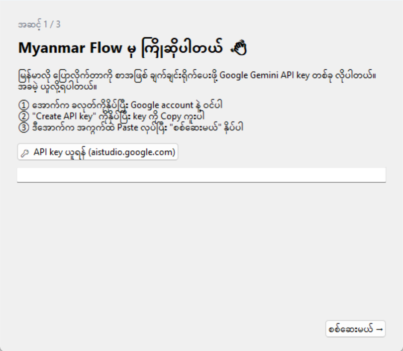
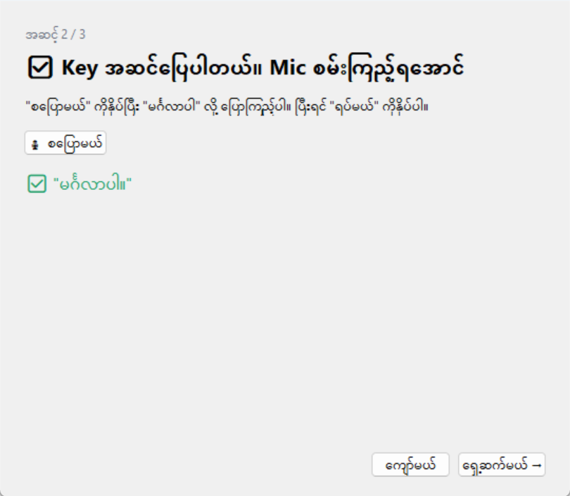
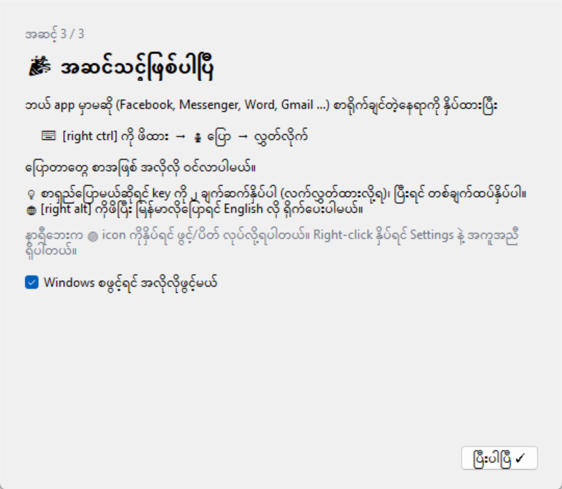
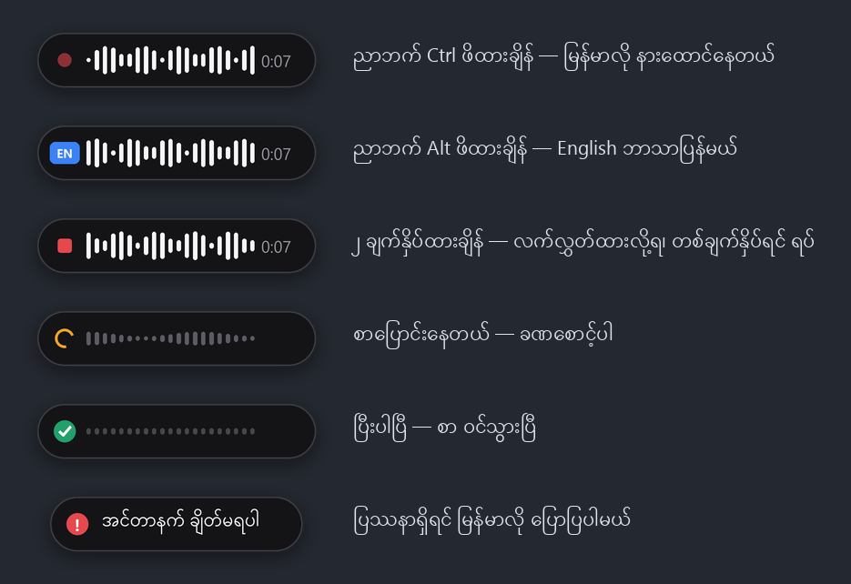
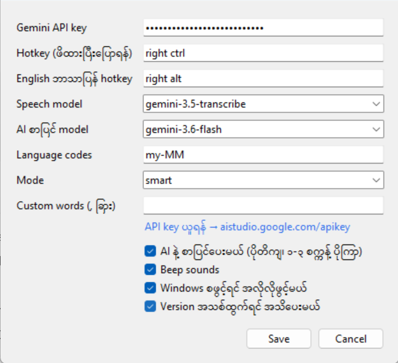

# 📘 Myanmar Flow — အသုံးပြုနည်း လမ်းညွှန် အပြည့်အစုံ

ဒီလမ်းညွှန်ကို အစကနေ အဆုံးထိ တစ်ခါဖတ်ပြီးရင် Myanmar Flow ကို ကောင်းကောင်း သုံးတတ်သွားပါလိမ့်မယ်။
ကွန်ပျူတာ သိပ်မကျွမ်းကျင်သူတွေလည်း လိုက်လုပ်လို့ရအောင် အဆင့်တိုင်းကို ရှင်းရှင်းလင်းလင်း ရေးထားပါတယ်။

---

## 📑 မာတိကာ

**အပိုင်း ၁ — စတင်အသုံးပြုခြင်း**
1. [Myanmar Flow ဆိုတာ ဘာလဲ](#s1)
2. [မစခင် လိုအပ်တာတွေ](#s2)
3. [Download နဲ့ Install လုပ်နည်း](#s3)
4. [Setup wizard (API key ထည့်ခြင်း)](#s4)

**အပိုင်း ၂ — နေ့စဉ်အသုံးပြုခြင်း**

5. [မြန်မာလို ပြောပြီး စာရိုက်နည်း](#s5)
6. [မြန်မာလိုပြောပြီး English စာထွက်နည်း](#s6)
7. [စာရှည်ရှည် လက်မလိုဘဲ ပြောနည်း](#s7)
8. [Screen အောက်က pill လေး](#s8)
9. [Tray icon နဲ့ menu](#s9)

**အပိုင်း ၃ — ပိုကောင်းအောင် သုံးခြင်း**

10. [Settings တစ်ခုချင်းစီ](#s10)
11. [ပိုတိကျအောင် ပြောနည်း](#s11)
12. [အသုံးပြုနိုင်တဲ့ အကြိမ်ရေ (limit) နဲ့ ကုန်ကျစရိတ်](#s12)
13. [Update လုပ်နည်း နဲ့ Uninstall လုပ်နည်း](#s13)

**အပိုင်း ၄ — အကူအညီ**

14. [ပြဿနာ ဖြေရှင်းနည်း](#s14)
15. [မေးလေ့ရှိတဲ့ မေးခွန်းများ (FAQ)](#s15)
16. [Privacy (ကိုယ်ရေးလုံခြုံမှု)](#s16)
17. [အကူအညီ တောင်းနည်း](#s17)

**[⚡ အတိုချုပ် cheat sheet](#cheat-sheet)** — အမြန်ပြန်ကြည့်ချင်ရင်

---

# အပိုင်း ၁ — စတင်အသုံးပြုခြင်း

<a name="s1"></a>

## 1. Myanmar Flow ဆိုတာ ဘာလဲ

Myanmar Flow က **မြန်မာလို ပြောလိုက်တာကို စာအဖြစ် ချက်ချင်း ရိုက်ပေးတဲ့** Windows program လေးပါ။

- **ဘယ် app မှာမဆို** သုံးလို့ရပါတယ် — Facebook, Messenger, Viber, Gmail, Word, Excel, Notepad, Chrome ... cursor (စာရိုက်တဲ့ မျဉ်းတောင်လေး) ရှိတဲ့ နေရာတိုင်းမှာ။
- Key တစ်ခုကို **ဖိထား → ပြော → လွှတ်** ရုံပါပဲ။ Keyboard နဲ့ မြန်မာစာ ရိုက်စရာ မလိုတော့ပါဘူး။
- မြန်မာလို ပြောပြီး **English စာ** ထွက်အောင်လည်း လုပ်လို့ရပါတယ်။
- AI က အကြားမှားတဲ့ စာလုံးတွေ၊ ပုဒ်ဖြတ် (၊ ။) တွေကို **အလိုလို ပြင်ပေး**ပါတယ်။

အသံကို စာပြောင်းဖို့ **Google Gemini** ကို သုံးပါတယ်။ ဒါကြောင့် **internet လိုပါတယ်**။

---

<a name="s2"></a>

## 2. မစခင် လိုအပ်တာတွေ

| လိုအပ်တာ | မှတ်ချက် |
|---|---|
| 💻 **Windows 10 သို့မဟုတ် 11** ကွန်ပျူတာ | Mac / ဖုန်း မရသေးပါ |
| 🎙️ **Microphone** | Laptop မှာ ပါပြီးသားပါ။ Headset mic ဆို ပိုကြည်ပါတယ် |
| 🌐 **Internet** | ပြောတိုင်း အသံကို Google ဆီ ပို့ရလို့ပါ |
| 📧 **Google account** (Gmail) | API key ယူဖို့ပါ — **အခမဲ့** |

> ⚠️ **မြန်မာနိုင်ငံထဲက သုံးမယ်ဆိုရင် သိထားရန်:**
> Google က Gemini API ကို [သုံးခွင့်ပြုထားတဲ့ နိုင်ငံစာရင်း](https://ai.google.dev/gemini-api/docs/available-regions) ထဲမှာ **မြန်မာနိုင်ငံ မပါသေးပါ**။
> ဒါကြောင့် မြန်မာပြည်ထဲကနေ သုံးရင် "ဒီနေရာကနေ Gemini သုံးခွင့်မရှိပါ" ဆိုတဲ့ error ပေါ်နိုင်ပါတယ်။
> ပြည်ပ (ထိုင်း၊ စင်္ကာပူ၊ မလေးရှား၊ ဂျပန် ...) မှာ နေတဲ့သူတွေကတော့ ပြဿနာ မရှိပါဘူး။

---

<a name="s3"></a>

## 3. Download နဲ့ Install လုပ်နည်း

### အဆင့် 3.1 — Download လုပ်ပါ

1. ဒီ link ကိုဖွင့်ပါ 👉 **https://github.com/ThecrashO/myanmar-flow/releases/latest**
2. စာမျက်နှာ အောက်နားက **Assets** ဆိုတဲ့ အပိုင်းမှာ ဖိုင် ၂ ခု တွေ့ပါမယ်:

| ဖိုင် | ဘယ်ဟာ ယူရမလဲ |
|---|---|
| **`MyanmarFlow-Setup.exe`** | ✅ **ဒါကို ယူပါ** (အများစုအတွက်) |
| `MyanmarFlow.exe` | Install မလုပ်ဘဲ USB ထဲကနေ တိုက်ရိုက် run ချင်သူတွေအတွက် |

3. `MyanmarFlow-Setup.exe` ကို နှိပ်ပြီး download လုပ်ပါ။
   Browser က "ဒီဖိုင်က အန္တရာယ်ရှိနိုင်တယ်" လို့ ပြောရင် **Keep** (သိမ်းထားမယ်) ကို ရွေးပါ။

### အဆင့် 3.2 — Install လုပ်ပါ

1. Download ထားတဲ့ `MyanmarFlow-Setup.exe` ကို **double-click** နှိပ်ပါ။
2. **အပြာရောင် box** — **"Windows protected your PC"** ပေါ်လာပါလိမ့်မယ်။ ဒါ ပုံမှန်ပါပဲ:
   - ① box ထဲက **More info** ဆိုတဲ့ စာကို နှိပ်ပါ
   - ② ပေါ်လာတဲ့ **Run anyway** ခလုတ်ကို နှိပ်ပါ

   > 🤔 **ဘာလို့ ဒီ box ပေါ်တာလဲ?** Myanmar Flow က အခမဲ့ open-source program ဖြစ်လို့ Microsoft ဆီကနေ ပိုက်ဆံပေးပြီး certificate မဝယ်ထားလို့ပါ။ Virus မဟုတ်ပါဘူး — code အားလုံးကို GitHub မှာ အများပြည်သူ ကြည့်လို့ရပါတယ်။

3. Install window မှာ:
   - ✅ **Start Myanmar Flow when Windows starts** — အမှန်ခြစ်ထားပါ (ကွန်ပျူတာဖွင့်တာနဲ့ အလိုလို ပွင့်လာမယ်)
   - ☐ **Create a desktop shortcut** — Desktop မှာ icon လိုချင်ရင် ခြစ်ပါ
   - **Next → Install → Finish** နှိပ်ပါ
4. Install ပြီးတာနဲ့ Myanmar Flow က အလိုလို ပွင့်လာပြီး **Setup wizard** ပေါ်လာပါမယ်။

> 💡 Admin password မလိုပါဘူး။ Install လုပ်ရတာ ၁၀ စက္ကန့်လောက်ပဲ ကြာပါတယ်။

---

<a name="s4"></a>

## 4. Setup wizard

ပထမဆုံး ဖွင့်တဲ့အခါ မြန်မာလို လမ်းပြပေးတဲ့ window ပေါ်လာပါမယ်။ အဆင့် ၃ ဆင့် ရှိပါတယ်။

### အဆင့် 4.1 — API key ထည့်ခြင်း



**API key ဆိုတာ** Google ရဲ့ အသံကို စာပြောင်းတဲ့ service ကို သုံးခွင့်ရဖို့ "သော့" လိုမျိုးပါ။ **အခမဲ့** ရပါတယ်။

**API key ယူနည်း (၂ မိနစ်):**

1. Wizard ထဲက **🔑 API key ယူရန်** ခလုတ်ကို နှိပ်ပါ → Browser မှာ Google AI Studio ပွင့်လာပါမယ်
2. Google account (Gmail) နဲ့ **Sign in** ဝင်ပါ
3. ပထမဆုံးအကြိမ်ဆိုရင် စည်းကမ်းချက်တွေ ပြပါလိမ့်မယ် — ဖတ်ပြီး လက်ခံပါ
4. **Create API key** ခလုတ်ကို နှိပ်ပါ
5. `AIza...` နဲ့စတဲ့ စာတန်းရှည်ကြီး ပေါ်လာပါမယ် — ဘေးက **Copy** ကို နှိပ်ပါ
6. Myanmar Flow wizard ကို ပြန်သွားပြီး အကွက်ထဲမှာ **Paste** လုပ်ပါ (`Ctrl + V`)
7. **စစ်ဆေးမယ် →** ကို နှိပ်ပါ

| ရလဒ် | အဓိပ္ပာယ် |
|---|---|
| နောက်အဆင့်ကို ရောက်သွားတယ် | ✅ Key မှန်ပါတယ် |
| ❌ API key မှားနေပါတယ် | Copy ကူးတုန်း တစ်ပိုင်းပဲ ပါသွားတာ ဖြစ်နိုင်ပါတယ် — ပြန် copy ကူးပါ |
| ❌ ဒီနေရာကနေ Gemini သုံးခွင့်မရှိပါ | [အပိုင်း ၂](#s2) ကိုကြည့်ပါ |
| ❌ အင်တာနက် ချိတ်မရပါ | Internet ချိတ်ထားလား စစ်ပါ |

> 🔒 **API key ကို ဘယ်သူ့ကိုမှ မပေးပါနဲ့** (Facebook မှာ မတင်ပါနဲ့၊ screenshot မပို့ပါနဲ့)။ ကိုယ့် key နဲ့ တခြားသူ သုံးရင် ကိုယ့် limit ကုန်သွားပါမယ်။

### အဆင့် 4.2 — Mic စမ်းခြင်း



1. **🎙 စပြောမယ်** ကို နှိပ်ပါ
2. "**မင်္ဂလာပါ**" လို့ ပြောပါ
3. **⏹ ရပ်မယ်** ကို နှိပ်ပါ
4. ✅ အစိမ်းရောင်နဲ့ ပြောတဲ့စာ ပြန်ပေါ်လာရင် အားလုံး အဆင်ပြေပါပြီ!

ပြဿနာ ရှိရင်:
- **"အသံ မကြားရပါ"** → Mic ချိတ်ထားလား၊ mute ဖြစ်နေလား စစ်ပါ
- **"Mic ကို ဖွင့်လို့မရပါ"** → Windows **Settings → Privacy & security → Microphone** မှာ "Let desktop apps access your microphone" ကို **On** လုပ်ပါ

ပြီးရင် **ရှေ့ဆက်မယ် →** နှိပ်ပါ။

### အဆင့် 4.3 — ပြီးပါပြီ



- **Windows စဖွင့်ရင် အလိုလိုဖွင့်မယ်** — အမှန်ခြစ်ထားဖို့ အကြံပြုပါတယ်
- **ပြီးပါပြီ ✓** နှိပ်ပါ

🎉 **ဒါဆိုရင် သုံးလို့ရပါပြီ!** Wizard ကို နောက်မှ ပြန်ဖွင့်ချင်ရင် tray icon → right-click → **Setup wizard...** ပါ။

---

# အပိုင်း ၂ — နေ့စဉ်အသုံးပြုခြင်း

<a name="s5"></a>

## 5. မြန်မာလို ပြောပြီး စာရိုက်နည်း

ဒါက အဓိက သုံးရမယ့်နည်းပါ။

1. စာရိုက်ချင်တဲ့ နေရာကို **mouse နဲ့ နှိပ်ထားပါ** (ဥပမာ Messenger ရဲ့ message box)
2. Keyboard ရဲ့ **ညာဘက် `Ctrl`** key ကို **ဖိထားပါ** — "တီ" ဆိုတဲ့ အသံလေး ကြားရပြီး screen အောက်မှာ pill လေး ပေါ်လာပါမယ်
3. **မြန်မာလို ပြောပါ**
4. ပြောပြီးရင် **key ကို လွှတ်လိုက်ပါ**
5. ၁-၃ စက္ကန့်အတွင်း စာ ဝင်လာပါမယ် ✅

> ⌨️ **ညာဘက် Ctrl ဆိုတာ** Keyboard အောက်ဆုံးတန်း၊ Space bar ရဲ့ ညာဘက်နားမှာ ရှိပါတယ်။ (ဘယ်ဘက် Ctrl က ပုံမှန် Copy/Paste အတွက် ဆက်သုံးလို့ရပါတယ် — Myanmar Flow က ဘယ်ဘက် Ctrl ကို မတုံ့ပြန်ပါဘူး)
>
> Laptop တချို့မှာ ညာဘက် Ctrl မပါရင် Settings မှာ တခြား key ပြောင်းလို့ရပါတယ် → [အပိုင်း ၁၀](#s10)

**English စကားလုံး ရောပြောလို့ ရလား?** ရပါတယ်။ "မနက်ဖြန် meeting ရှိတယ်" လို့ ပြောရင် "meeting" ကို English လိုပဲ ရေးပေးပါတယ်။

---

<a name="s6"></a>

## 6. မြန်မာလိုပြောပြီး English စာထွက်နည်း

English လို email / message ရေးရမယ်၊ ဒါပေမဲ့ မြန်မာလို ပြောချင်တယ်ဆိုရင်:

1. စာရိုက်ချင်တဲ့နေရာကို နှိပ်ထားပါ
2. **ညာဘက် `Alt`** ကို **ဖိထားပါ** — pill မှာ အပြာရောင် **EN** ပေါ်လာပါမယ်
3. **မြန်မာလို** ပြောပါ
4. လွှတ်လိုက်ရင် **English** လို ဘာသာပြန်ပြီး ရိုက်ပေးပါမယ်

**ဥပမာ:** "မနက်ဖြန် ၁၀ နာရီ meeting ကို ၁၁ နာရီ ရွှေ့လို့ရမလား" လို့ ပြောရင်
→ *"Could we move tomorrow's 10 o'clock meeting to 11?"* လိုမျိုး ထွက်လာပါမယ်။

---

<a name="s7"></a>

## 7. စာရှည်ရှည် လက်မလိုဘဲ ပြောနည်း

စာရှည်ရှည် ပြောရမယ်ဆိုရင် key ကို တောက်လျှောက် ဖိထားရတာ ညောင်းပါတယ်။ ဒါကြောင့်:

1. **ညာဘက် Ctrl** ကို **၂ ချက် ဆက်တိုက်** မြန်မြန်လေး နှိပ်ပါ (double-click လိုမျိုး)
2. "တီ" အသံ မြင့်မြင့်လေး ကြားရပြီး pill မှာ **■ (လေးထောင့်)** ပေါ်လာပါမယ်
3. **လက်လွှတ်ထားပြီး** စိတ်ကြိုက် ပြောပါ
4. ပြီးရင် ညာဘက် Ctrl ကို **တစ်ချက် ထပ်နှိပ်ပါ** → စာ ဝင်လာပါမယ်

- English mode နဲ့လည်း ရပါတယ် — **ညာဘက် Alt** ကို ၂ ချက်နှိပ်ပါ
- တစ်ခါပြောရင် **အများဆုံး ၅ မိနစ်** ပါ။ ၅ မိနစ်ပြည့်ရင် အလိုလို ရပ်ပြီး စာပြောင်းပေးပါတယ်

---

<a name="s8"></a>

## 8. Screen အောက်က pill လေး

Key နှိပ်လိုက်တာနဲ့ screen အောက်ဘက် အလယ်မှာ pill ပုံစံ အမည်းရောင်လေး ပေါ်လာပါတယ်။ ဘာဖြစ်နေလဲဆိုတာ ပြပေးပါတယ်:



| မြင်ရတာ | အဓိပ္ပာယ် |
|---|---|
| 🔴 အနီစက် + လှိုင်းလေးတွေ + `0:07` | နားထောင်နေတယ် — ကိုယ့်အသံအလိုက် လှိုင်းတွေ လှုပ်နေရင် mic အလုပ်လုပ်နေတာပါ |
| 🔵 **EN** | English ဘာသာပြန် mode |
| 🟥 ■ လေးထောင့် | လက်မလို mode — key တစ်ချက်နှိပ်ရင် ရပ်မယ် |
| 🟠 လည်နေတဲ့ စက်ဝိုင်း | စာပြောင်းနေတယ် — ခဏစောင့်ပါ |
| ✅ အစိမ်း check | ပြီးပါပြီ — စာ ဝင်သွားပြီ |
| ❗ အနီ + မြန်မာစာ | ပြဿနာ — ဘာဖြစ်လဲ မြန်မာလို ပြောပြပါတယ် ([အပိုင်း ၁၄](#s14)) |

> 💡 **လှိုင်းလေးတွေ မလှုပ်ဘူးဆိုရင်** mic က အသံ မရနေတာပါ — mic ကို စစ်ပါ။

Pill က ကိုယ်ရိုက်နေတဲ့ app ကို မနှောင့်ယှက်ပါဘူး — mouse နဲ့ နှိပ်မိရင်လည်း နောက်ကွယ်က app ကိုပဲ နှိပ်မိတာပါ။

---

<a name="s9"></a>

## 9. Tray icon နဲ့ menu

Myanmar Flow က window မရှိဘဲ **နာရီဘေးနားမှာ** icon လေးအနေနဲ့ နေပါတယ်။


**Icon ကို မတွေ့ရင်:** နာရီဘေးက **`^`** (မြှားလေး) ကို နှိပ်ပါ — ဝှက်ထားတဲ့ icon တွေ ပေါ်လာပါမယ်။
အမြဲမြင်ရအောင် icon ကို taskbar ပေါ်ကို ဆွဲတင်ထားလို့ ရပါတယ်။

**Icon ကို ဘယ်ကလစ် တစ်ချက်နှိပ်ရင်** → ဖွင့်/ပိတ် (🟢 ↔ ⚪)
ခဏ မသုံးချင်ရင် (ဥပမာ game ဆော့နေရင်) ပိတ်ထားလို့ရပါတယ်။

**Icon ကို Right-click နှိပ်ရင် ပေါ်လာတဲ့ menu:**

| Menu | လုပ်ဆောင်ချက် |
|---|---|
| **ပိတ်ရန် / ဖွင့်ရန်** | ခဏ ရပ်ထားရန် / ပြန်ဖွင့်ရန် |
| **⬆ Version အသစ် ရယူရန်** | Version အသစ် ထွက်မှ ပေါ်ပါတယ် ([အပိုင်း ၁၃](#s13)) |
| **Settings...** | Setting တွေ ပြောင်းရန် ([အပိုင်း ၁၀](#s10)) |
| **Setup wizard...** | API key ပြန်ထည့်ရန်၊ mic ပြန်စမ်းရန် |
| **အကူအညီ (Help)** | ဒီလမ်းညွှန်ကို ဖွင့်ပေးတယ် |
| **ပြဿနာတင်ပြရန်** | အကူအညီ တောင်းရန် ([အပိုင်း ၁၇](#s17)) |
| **Log ဖိုင်ဖွင့်ရန်** | Error မှတ်တမ်း ကြည့်ရန် |
| **Version 1.x.x** | လက်ရှိ version |
| **Quit** | Program ကို လုံးဝ ပိတ်ရန် |

---

# အပိုင်း ၃ — ပိုကောင်းအောင် သုံးခြင်း

<a name="s10"></a>

## 10. Settings တစ်ခုချင်းစီ

Tray icon → Right-click → **Settings...**



| Setting | ဘာလဲ | ပုံမှန် |
|---|---|---|
| **Gemini API key** | သင့် API key | — |
| **Hotkey (ဖိထားပြီးပြောရန်)** | မြန်မာလို ရိုက်ဖို့ key | `right ctrl` |
| **English ဘာသာပြန် hotkey** | English ထွက်ဖို့ key။ မလိုရင် ဗလာ ထားပါ | `right alt` |
| **Speech model** | အသံကို စာပြောင်းတဲ့ AI | `gemini-3.5-transcribe` |
| **AI စာပြင် model** | စာကို ပြန်ပြင်ပေးတဲ့ AI | `gemini-3.6-flash` |
| **Language codes** | ပြောမယ့် ဘာသာ | `my-MM` (မြန်မာ) |
| **Mode** | `smart` = သပ်ရပ်အောင် ပြင်ပေး / `verbatim` = ပြောသမျှ အတိအကျ | `smart` |
| **Custom words** | မကြာခဏ မှားတဲ့ နာမည်/စကားလုံးတွေ (`,` နဲ့ ခြားပါ) | ဗလာ |
| **AI နဲ့ စာပြင်ပေးမယ်** | ပိုတိကျ၊ ဒါပေမဲ့ ၁-၃ စက္ကန့် ပိုကြာ | ✅ |
| **Beep sounds** | စ/ရပ်တဲ့အခါ "တီ" အသံ | ✅ |
| **Windows စဖွင့်ရင် အလိုလိုဖွင့်မယ်** | | ✅ |
| **Version အသစ်ထွက်ရင် အသိပေးမယ်** | | ✅ |

ပြင်ပြီးရင် **Save** နှိပ်ပါ — ချက်ချင်း သက်ရောက်ပါတယ် (restart လုပ်စရာ မလိုပါ)။

### Hotkey ပြောင်းနည်း

Hotkey အကွက်မှာ key နာမည်ကို English စာလုံးအသေးနဲ့ ရိုက်ထည့်ပါ:

| ရိုက်ရမှာ | Key |
|---|---|
| `right ctrl` | ညာဘက် Ctrl |
| `right alt` | ညာဘက် Alt |
| `right shift` | ညာဘက် Shift |
| `f8`, `f9`, ... | Function keys |
| `scroll lock`, `pause` | သုံးလေ့မရှိတဲ့ key တွေ — ကောင်းပါတယ် |

> ⚠️ Hotkey ၂ ခု မတူရပါ။ စာရိုက်ရာမှာ သုံးနေတဲ့ key (ဥပမာ `space`, `a`) ကို မရွေးပါနဲ့။

### Custom words ဥပမာ

သင့်နာမည်၊ ကုမ္ပဏီနာမည်၊ မြို့နာမည် စတာတွေ မကြာခဏ မှားနေရင် ထည့်ပါ:

```
ကျော်ဇင်, ရွှေတောင်ကုမ္ပဏီ, မော်လမြိုင်, Myanmar Flow
```

---

<a name="s11"></a>

## 11. ပိုတိကျအောင် ပြောနည်း

| ✅ လုပ်ပါ | ❌ ရှောင်ပါ |
|---|---|
| Key ဖိပြီး **ခဏ (½ စက္ကန့်)** နေမှ စပြောပါ | Key နှိပ်တာနဲ့ ချက်ချင်း စပြောတာ (ရှေ့စာလုံး ပြတ်နိုင်) |
| ပြောပြီး **ခဏနေမှ** လွှတ်ပါ | စကားမဆုံးခင် လွှတ်တာ |
| ပုံမှန်အသံ၊ ပုံမှန်အမြန်နှုန်းနဲ့ ပြောပါ | တိုးတိုးလေး / အရမ်းမြန်မြန် ပြောတာ |
| Mic နဲ့ လက်တစ်ထွာလောက် နီးနီး ပြောပါ | အခန်းတစ်ဖက်ကနေ ပြောတာ |
| တိတ်ဆိတ်တဲ့နေရာ | TV / သီချင်း ဖွင့်ထားတာ |
| ဝါကျ ၁-၃ ကြောင်းစီ ပြောပါ | စာမျက်နှာတစ်ခုလုံး တစ်ခါတည်း |

**မှားတာ များနေသေးရင်:**
1. Settings → **AI နဲ့ စာပြင်ပေးမယ်** ✅ ဖွင့်ထားလား စစ်ပါ
2. ခဏခဏ မှားတဲ့ စကားလုံးကို **Custom words** မှာ ထည့်ပါ
3. Headset / earphone mic သုံးကြည့်ပါ — laptop mic ထက် အများကြီး ကြည်ပါတယ်
4. Settings → **Speech model** ကို `gemini-3.1-pro-preview` ပြောင်းကြည့်ပါ (ပိုနှေးပေမဲ့ ပိုတိကျနိုင်)

---

<a name="s12"></a>

## 12. အသုံးပြုနိုင်တဲ့ အကြိမ်ရေ (limit) နဲ့ ကုန်ကျစရိတ်

**Myanmar Flow က ဘာမှ ကန့်သတ်မထားပါဘူး၊ ပိုက်ဆံလည်း မယူပါဘူး။** ကန့်သတ်ချက်က Google ဘက်က ဖြစ်ပါတယ်။

| | Free (အခမဲ့) | Billing ဖွင့်ထားရင် |
|---|---|---|
| ကုန်ကျစရိတ် | 💚 အခမဲ့ | သုံးသလောက် ပေးရ (တစ်ခါပြောတာ အလွန်နည်း) |
| Limit | **တစ်ရက်ကို အကြိမ်ရေ နည်းနည်းပဲ** (ဥပမာ `gemini-3.5-transcribe` က တစ်ရက် ~၂၅ ကြိမ်) | အများကြီး |

- Limit ပြည့်ရင် pill မှာ **"သုံးနိုင်တဲ့ အကြိမ်ရေ ပြည့်သွားပြီ"** ပေါ်ပါမယ်။ နောက်တစ်ရက် ပြန်ရပါတယ်။
- တကယ့် limit အရေအတွက်က Google က ပြောင်းလဲနိုင်ပါတယ် — [Google ရဲ့ limit စာမျက်နှာ](https://ai.google.dev/gemini-api/docs/rate-limits) မှာ ကြည့်ပါ။
- **AI စာပြင်** ဖွင့်ထားရင် တစ်ခါပြောတိုင်း Google ကို ၂ ကြိမ် ခေါ်ပါတယ် (model မတူလို့ limit သီးသန့်စီ ရှိပါတယ်)။

**နေ့တိုင်း အများကြီး သုံးမယ်ဆိုရင်** → [aistudio.google.com](https://aistudio.google.com) → သင့် API key ရဲ့ project → **Set up billing** နဲ့ card ချိတ်ပါ။ စျေးနှုန်းကို [Google ရဲ့ pricing စာမျက်နှာ](https://ai.google.dev/gemini-api/docs/pricing) မှာ ကြည့်နိုင်ပါတယ်။

---

<a name="s13"></a>

## 13. Update လုပ်နည်း နဲ့ Uninstall လုပ်နည်း

### Update

Version အသစ် ထွက်ရင်:
1. နာရီဘေးမှာ **"Version x.x.x ထွက်ပါပြီ"** notification ပေါ်လာပါမယ်
2. Tray icon → Right-click → **⬆ Version အသစ် ရယူရန်** နှိပ်ပါ
3. ပွင့်လာတဲ့ စာမျက်နှာကနေ **`MyanmarFlow-Setup.exe`** ကို download လုပ်ပြီး install လုပ်ပါ
4. ဟောင်းတဲ့ version ပေါ်ကို အလိုလို အစားထိုးပေးပါတယ် — **API key နဲ့ setting တွေ မပျောက်ပါဘူး**

> v1.0.x သုံးနေသူတွေကတော့ notification မရပါဘူး (v1.1.0 ကစပြီး ပါတာမို့) — [Releases](https://github.com/ThecrashO/myanmar-flow/releases/latest) ကနေ ကိုယ်တိုင် download လုပ်ပါ။

### Uninstall (ဖျက်ချင်ရင်)

1. Windows **Settings → Apps → Installed apps**
2. **Myanmar Flow** ကိုရှာ → **⋯** → **Uninstall**
3. Program နဲ့ setting တွေ (API key အပါအဝင်) အကုန် ဖျက်ပေးပါတယ်

---

# အပိုင်း ၄ — အကူအညီ

<a name="s14"></a>

## 14. ပြဿနာ ဖြေရှင်းနည်း

### Pill မှာ ပေါ်တဲ့ error များ

| Pill မှာ ပြတဲ့စာ | ဖြစ်ရတဲ့ အကြောင်း | ဖြေရှင်းနည်း |
|---|---|---|
| **အင်တာနက် ချိတ်မရပါ** | Internet မရှိ | WiFi / data စစ်ပါ |
| **အင်တာနက် နှေးလွန်းပါတယ်** | Internet နှေး | ခဏနေ ပြန်စမ်းပါ၊ စာတိုတို ပြောပါ |
| **ဒီနေရာကနေ Gemini သုံးခွင့်မရှိပါ** | Google က သင့်နိုင်ငံကို ခွင့်မပြု | [အပိုင်း ၂](#s2) ကိုကြည့်ပါ |
| **API key မှားနေပါတယ်** | Key မှား / ဖျက်ခံရ | Right-click → **Setup wizard** နဲ့ key အသစ် ထည့်ပါ |
| **သုံးနိုင်တဲ့ အကြိမ်ရေ ပြည့်သွားပြီ** | Google limit ပြည့် | နောက်ရက် ပြန်သုံးပါ၊ ဒါမှမဟုတ် [billing ဖွင့်ပါ](#s12) |
| **Model နာမည် မှားနေပါတယ်** | Settings မှာ model နာမည် မှား | Speech model ကို `gemini-3.5-transcribe` ပြန်ထားပါ |
| **Mic ဖွင့်လို့မရပါ** | Mic ခွင့်ပြုချက် မရှိ | Windows Settings → Privacy & security → **Microphone** → Desktop apps **On** |
| **ဘာသာပြန်လို့မရလို့ မြန်မာလိုပဲ ထည့်ထားပါတယ်** | English ပြန်တာ မအောင်မြင် | ပြန်စမ်းပါ |

### Error မပြဘဲ ဖြစ်တတ်တဲ့ ပြဿနာများ

| ပြဿနာ | ဖြေရှင်းနည်း |
|---|---|
| **Key နှိပ်လည်း ဘာမှ မဖြစ်ဘူး** | ① Tray icon **🟢 အစိမ်း** ဖြစ်နေလား (⚪ ဆိုရင် တစ်ချက်နှိပ်ပြီး ဖွင့်ပါ) ② Icon လုံးဝ မရှိရင် Start menu → **Myanmar Flow** ဖွင့်ပါ ③ **ညာဘက်** Ctrl ကို နှိပ်နေတာ သေချာလား |
| **App တစ်ခုတည်းမှာပဲ မရဘူး** | အဲဒီ app က Administrator နဲ့ run နေတာ ဖြစ်နိုင်ပါတယ် (ဥပမာ game တချို့၊ Task Manager)။ Myanmar Flow ကို right-click → **Run as administrator** နဲ့ ဖွင့်ပါ |
| **Pill ပေါ်တယ်၊ လှိုင်းတွေ မလှုပ်ဘူး** | Mic က အသံ မရ — Windows sound settings မှာ mic မှန်တာ ရွေးထားလား၊ mute ဖြစ်နေလား စစ်ပါ |
| **စာ ဝင်မလာဘူး (✅ ပြတယ်)** | စာရိုက်တဲ့ အကွက်ကို mouse နဲ့ အရင် နှိပ်ထားလား စစ်ပါ (cursor တောင်လေး မှိတ်တုတ်မှိတ်တုတ် ဖြစ်နေရမယ်)။ ပြီးရင် ပြန်ပြောပါ |
| **ညာဘက် Alt နှိပ်ရင် app ရဲ့ menu ပွင့်လာတယ်** | Settings မှာ English hotkey ကို တခြား key (ဥပမာ `right shift`) ပြောင်းပါ |
| **ကွန်ပျူတာဖွင့်ရင် အလိုလို မပွင့်ဘူး** | Settings → **Windows စဖွင့်ရင် အလိုလိုဖွင့်မယ်** ✅ ခြစ်ပြီး Save |
| **"Myanmar Flow က ဖွင့်ထားပြီးသားပါ"** | နှစ်ခါ ဖွင့်မိလို့ပါ — tray မှာ icon ရှိပြီးသားပါ |
| **မြန်မာစာ ကွဲနေတယ် / ဇော်ဂျီ** | Myanmar Flow က **Unicode** နဲ့ ရိုက်ပါတယ်။ ဇော်ဂျီ font သုံးထားတဲ့ ဖုန်း/ကွန်ပျူတာမှာ ကွဲမြင်ရနိုင်ပါတယ် |

### Log ဖိုင်

ပြဿနာ အတိအကျ သိချင်ရင် Right-click → **Log ဖိုင်ဖွင့်ရန်** — `ERROR` ပါတဲ့ စာကြောင်းတွေကို ကြည့်ပါ။
Log ထဲမှာ **ပြောတဲ့စာ မပါပါဘူး** (စာလုံးအရေအတွက်ပဲ ပါပါတယ်)။

---

<a name="s15"></a>

## 15. မေးလေ့ရှိတဲ့ မေးခွန်းများ (FAQ)

<details>
<summary><b>ပိုက်ဆံ ပေးရလား?</b></summary>

Myanmar Flow က **အခမဲ့** ပါ။ Google API key ကလည်း free tier နဲ့ အခမဲ့ သုံးလို့ရပါတယ် (တစ်ရက် limit ရှိ)။ အများကြီး သုံးချင်ရင် Google ကို billing ဖွင့်ပြီး သုံးသလောက် ပေးရပါတယ် — [အပိုင်း ၁၂](#s12)။
</details>

<details>
<summary><b>Internet မရှိဘဲ သုံးလို့ရလား?</b></summary>

မရပါ။ အသံကို Google ရဲ့ AI က စာပြောင်းပေးတာမို့ internet လိုပါတယ်။
</details>

<details>
<summary><b>ဖုန်း / Mac မှာ သုံးလို့ရလား?</b></summary>

အခုလောလောဆယ် **Windows** ပဲ ရပါသေးတယ်။
</details>

<details>
<summary><b>ပြောတဲ့ အသံတွေ ဘယ်ကို ရောက်သွားလဲ?</b></summary>

သင့်ကိုယ်ပိုင် API key နဲ့ **Google Gemini ဆီကိုပဲ** ပို့ပါတယ်။ Myanmar Flow မှာ ကိုယ်ပိုင် server မရှိပါဘူး — [အပိုင်း ၁၆](#s16)။
</details>

<details>
<summary><b>Copy ကူးထားတဲ့ စာတွေ ပျောက်သွားမလား?</b></summary>

**စာ** ဆိုရင် မပျောက်ပါဘူး — Myanmar Flow က clipboard ကို ခဏသုံးပြီး စာထည့်ပြီးတာနဲ့ မူလ copy ကူးထားတဲ့ စာကို ပြန်ထားပေးပါတယ်။
**ပုံ / ဖိုင်** copy ကူးထားရင်တော့ ပျောက်သွားနိုင်လို့ paste မလုပ်ရသေးခင် Myanmar Flow နဲ့ မပြောပါနဲ့။
</details>

<details>
<summary><b>ဇော်ဂျီနဲ့ ရိုက်ပေးလို့ ရလား?</b></summary>

မရပါ။ **Unicode** နဲ့ပဲ ရိုက်ပါတယ်။ Facebook၊ Gmail၊ Windows အားလုံး Unicode ကို ထောက်ပံ့ပါတယ်။
</details>

<details>
<summary><b>ကွန်ပျူတာ နှေးသွားမလား?</b></summary>

မနှေးပါဘူး။ Key နှိပ်ထားချိန်မှာပဲ အလုပ်လုပ်ပြီး ကျန်တဲ့အချိန် ဘာမှ မလုပ်ပါဘူး။
</details>

<details>
<summary><b>ကွန်ပျူတာ တစ်လုံးထက်ပိုပြီး key တစ်ခုတည်း သုံးလို့ရလား?</b></summary>

ရပါတယ်။ ဒါပေမဲ့ limit ကို မျှသုံးရမှာပါ။ မိသားစု / သူငယ်ချင်းတွေကိုတော့ ကိုယ်ပိုင် key ယူခိုင်းတာ ပိုကောင်းပါတယ်။
</details>

---

<a name="s16"></a>

## 16. Privacy (ကိုယ်ရေးလုံခြုံမှု)

- 🎙️ **Key ဖိထားချိန်မှာပဲ** အသံဖမ်းပါတယ်။ ကျန်တဲ့အချိန် mic ကို မသုံးပါဘူး။
- 📤 အသံနဲ့ စာကို **သင့် API key နဲ့ Google Gemini ဆီကိုပဲ** ပို့ပါတယ်။ ကြားထဲမှာ တခြား server မရှိပါဘူး။ Google က data ကို ဘယ်လို ကိုင်တွယ်လဲဆိုတာ [Gemini API Terms](https://ai.google.dev/gemini-api/terms) မှာ ဖတ်နိုင်ပါတယ်။
- 💾 API key နဲ့ setting တွေကို **သင့်ကွန်ပျူတာထဲမှာပဲ** သိမ်းပါတယ် (`%APPDATA%\MyanmarFlow\config.json`)။
- 📝 Log ဖိုင်ထဲမှာ **ပြောတဲ့စာကို မသိမ်းပါဘူး**။
- 🔄 Update ရှိမရှိ စစ်ဖို့ တစ်ရက်တစ်ခါ GitHub ကို နောက်ဆုံး version နံပါတ် မေးပါတယ် (သင့်အသံ၊ စာ၊ key မပို့ပါ)။ Settings မှာ ပိတ်လို့ရပါတယ်။
- 🔓 Code အားလုံးကို [GitHub](https://github.com/ThecrashO/myanmar-flow) မှာ ဘယ်သူမဆို စစ်ကြည့်လို့ရပါတယ်။

---

<a name="s17"></a>

## 17. အကူအညီ တောင်းနည်း

ဒီလမ်းညွှန်မှာ အဖြေမတွေ့ရင်:

1. Tray icon → Right-click → **ပြဿနာတင်ပြရန်** (သို့မဟုတ် 👉 [ဒီမှာ နှိပ်ပါ](https://github.com/ThecrashO/myanmar-flow/issues/new/choose))
2. **🐞 ပြဿနာ တင်ပြရန်** ကို ရွေးပြီး form ကို ဖြည့်ပါ — မြန်မာလို ရေးလို့ရပါတယ်
3. GitHub account လိုပါတယ် (အခမဲ့ — [github.com/signup](https://github.com/signup))

**ပိုမြန်မြန် အဖြေရဖို့ ထည့်ပေးပါ:**
- ဘာလုပ်နေတုန်း ဖြစ်တာလဲ
- Pill မှာ ဘာပြလဲ (screenshot ပါရင် ပိုကောင်း)
- Right-click → **Log ဖိုင်ဖွင့်ရန်** ထဲက `ERROR` စာကြောင်းများ
- Version နံပါတ် (Right-click menu ထဲမှာ ပါပါတယ်)

> 🔒 **API key ကို ဘယ်တော့မှ မတင်ပါနဲ့။** Screenshot / log မှာ key ပါမပါ အရင် စစ်ပါ။

**အကြံဉာဏ် ပေးချင်ရင်** 👉 [💡 Feature အကြံပြုရန်](https://github.com/ThecrashO/myanmar-flow/issues/new/choose)

---

<a name="cheat-sheet"></a>

## ⚡ အတိုချုပ် cheat sheet

| လုပ်ချင်တာ | လုပ်ရမှာ |
|---|---|
| 🇲🇲 မြန်မာလို ရိုက်မယ် | **ညာ Ctrl** ဖိ → ပြော → လွှတ် |
| 🇬🇧 မြန်မာလိုပြော၊ English ထွက် | **ညာ Alt** ဖိ → ပြော → လွှတ် |
| 🙌 စာရှည် လက်မလို | Key **၂ ချက်** နှိပ် → ပြော → **၁ ချက်** နှိပ် |
| ⏸️ ခဏ ရပ်ထား | Tray icon **ဘယ်ကလစ်** |
| ⚙️ Setting ပြောင်း | Tray icon **Right-click → Settings** |
| 🔑 Key ပြန်ထည့် | Tray icon **Right-click → Setup wizard** |
| 🆘 အကူအညီ | Tray icon **Right-click → ပြဿနာတင်ပြရန်** |

---

<p align="center">
<a href="../README.md">⬅️ README သို့ ပြန်သွားရန်</a> · <a href="https://github.com/ThecrashO/myanmar-flow/releases/latest">⬇️ Download</a>
</p>
